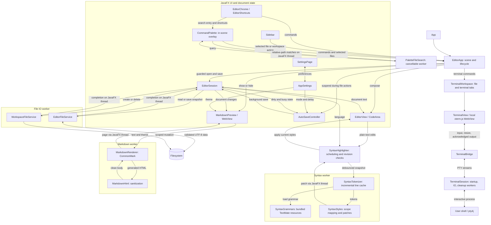

# Architecture

[Documentation index](README.md) · [Complete file reference](file-reference.md)

Production classes share the package `dev.somgester.sylph` in the single Gradle `app` module. Most implementation classes are package-private. The application separates document state, disk operations, presentation, and background rendering.

## Main flow as of now

Arrows show commands and data flow, not every constructor dependency. Worker results return to the JavaFX thread before updating controls.

`EditorApp` owns the scene and connects these components. It coordinates dialogs, foreground file actions, theme changes, preview visibility, and shutdown. `EditorChrome` means the surrounding menus/toolbars, not the text document or a browser engine.

## Document lifecycle and disk work

`EditorSession` exposes observable text, path, language, dirty state, busy state, editing-blocked state, and status. Its executor performs file tasks away from the JavaFX thread. Completion handlers accept the current operation only, so late results cannot replace a newer state or resurrect a closed session.

`EditorView` synchronizes plain-text changes with the session and owns selection, line numbers, undo/redo, and the syntax highlighter. Style changes must never become document edits or trigger saves. A successful open marks a new document even when its text equals the previous document; Save As changes the path without resetting editing history.

`WorkspaceFileService` validates workspace containment and names, creates without replacement, and deletes selected trees relative to `SecureDirectoryStream` handles without following symlinks. Deletion opens all ancestors without following links and fails before mutation if secure handles are unavailable. Active-document checks resolve parent-directory aliases before the unsaved decision and capture the affected-document state before deletion, so completion does not depend on resolving a removed path. `EditorSession.mutateWorkspace` runs these operations on the existing file worker. `EditorApp` holds the file-action autosave suspension across prompts and worker completion, clearing the active document only after a successful affected deletion. Sidebar context menus capture the target path when shown; directory refreshes retain existing nodes and reject superseded results.

`EditorFileService` returns snapshots containing path, normalized text, line-ending convention, BOM flag, and a SHA-256 digest. Save compares on-disk content with the expected digest, writes a temporary sibling, preserves existing POSIX permissions when supported, rechecks the digest, and atomically replaces an existing destination. New destinations use a move without replacement. Temporary files are cleaned up in `finally`.

These checks detect external modifications but are not a filesystem lock or a guarantee against every concurrent writer race. File bytes and editor text are held in memory; this is not a streaming large-file editor.

## Autosave and foreground actions

`AutoSaveController` observes the session and settings. Generation numbers invalidate queued timer callbacks. Nested suspension handles pause saving across a confirmation and its following chooser/save/load flow. Releasing a handle is idempotent; closing the controller removes listeners and invalidates callbacks.

`busy` covers any file operation. `editingBlocked` distinguishes foreground operations from background autosaves. The sidebar binds to `editingBlocked`, preventing autosave from repeatedly changing its disabled appearance. File-action coordination still prevents overlapping operations; it does not queue navigation clicks during a save.

## Thread boundaries and disposal

- Scene changes, properties used by controls, and application of rendered results stay on the JavaFX application thread.
- File IO belongs to the session executor; sidebar directory discovery also uses asynchronous tasks.
- Syntax tokenization uses one worker with its own grammar registry and line cache. Immutable results cross back to JavaFX.
- Markdown rendering uses background work and rejects obsolete results before applying them to WebView.
- Owners close views/controllers, detach listeners, cancel pending work, and shut down their workers. Preserve these paths when introducing new asynchronous features.

## Theme and preview boundaries

`dark.css` and `light.css` supply theme colors. `shell.css`, `editor.css`, and `settings.css` style JavaFX components using those values. `markdown.css` is browser CSS embedded into preview HTML; it is not a JavaFX stylesheet.

`MarkdownRenderer` parses Markdown with table and strikethrough extensions and cleans the complete generated body through `MarkdownHtml`. Cleaning the full body preserves paired inline HTML and block structure. Preview pages also include a restrictive content policy, and WebView JavaScript is disabled. Same-document scroll restoration belongs to `MarkdownPreview`, not the renderer.

## Terminal lifecycle

`TerminalWorkspace` is created lazily when the first terminal command runs. It preserves the existing document view inside an unclosable file tab, adds terminal tabs in the editor or a vertical split panel, and closes sessions when tabs are removed. Hiding the panel retains processes; duplicate starts an independent session in the same initial folder.

`TerminalSession` owns a real pty4j process and separate reader/input workers. UTF-8 output crosses to `TerminalView` one chunk at a time, with an acknowledgement from xterm.js before reading the next chunk. `TerminalBridge` is public for WebKit's reflective calls and exposes only input/resize/acknowledgement operations. Output crosses the bridge as data. Startup and termination run outside JavaFX; a close during startup waits for process registration before cleanup. Closing releases streams and terminates observed descendants as well as the shell. `TerminalPage` embeds bundled assets with a fresh script nonce so resource loading works from both class directories and packaged JARs. The local terminal page uses a restrictive content policy and does not share Markdown's WebView or document session.

See the [terminal guide](terminal.md) for shortcuts, shell selection, dependency maintenance, and platform verification limits.

## Command palette and window reload

`CommandPalette` is an unmanaged overlay attached to the scene's `BorderPane`. It inherits theme colors, resizes with its host, retains the previous focus owner, and routes chosen files through the existing guarded open flow. Commands share `EditorShortcuts`; availability is checked before display and activation. `PaletteFileSearch` scans on a dedicated cancellable worker with capped matches and skips dependency/cache trees and symlinks. Query revisions reject stale results. Existing rows remain visible during a search, replacements publish in a single list update, and activation requires the displayed revision to match the current query. Matching selections survive replacements. `PaletteMatch` shares literal, case-insensitive query matching and UTF-16 highlight ranges; row graphics use theme-aware TextFlow spans. `RecentFiles` keeps a bounded, normalized history and persists it in production through Java preferences; tests use an isolated memory store. Only successful foreground opens/saves reorder history, and recent-file existence checks run on the search worker.

Reload uses the existing file-action suspension and unsaved decision before disposing terminal sessions, the old palette, settings listeners, editor, autosave controller, and session. It reconstructs the scene with the same preferences, restores window dimensions, and reopens the saved path and workspace folder. The old title and theme bindings are released before replacement.

## Maintenance boundaries

Keep filesystem validation in the file service, document state in the session, command wiring in the app/shortcuts, and visual rules in the relevant stylesheets. Test changes at the boundary they affect: disk contents for saves, actual style spans for highlighting, and headless JavaFX scenes for lifecycle and layout. See [testing](testing.md) and [grammar maintenance](syntax-highlighting.md).
